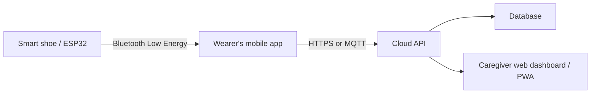

# SmartStep

SmartStep is a responsive safety-footwear monitoring dashboard developed for
the **EE3180 Design and Innovation Project**. It provides a clear interface for
caregivers to monitor a wearer's live location, smart-shoe battery condition,
safety zones, alerts, movement activity, and device connectivity.

The current release is a front-end prototype with realistic simulated data. It
is also configured as an installable Progressive Web App (PWA) for Android and
iOS home screens.

## Features

- Responsive dashboard for desktop, tablet, and mobile screens
- Live OpenStreetMap display with wearer marker and battery information
- Safe-zone and hazardous-zone visualization
- Battery level, voltage, temperature, and remaining-time estimates
- Critical, warning, and read/unread alert management
- Device connection and Bluetooth signal status
- Movement activity summary and CSV report export
- Collapsible desktop navigation and mobile bottom navigation
- Login/logout demonstration flow
- Installable PWA with application icon and basic offline caching

## Technology stack

| Layer | Technology |
| --- | --- |
| UI | React 19, TypeScript, Tailwind CSS |
| Application framework | vinext / Vite |
| Maps | Leaflet and OpenStreetMap |
| PWA | Web App Manifest and Service Worker |
| Optional data layer | Drizzle ORM and Cloudflare D1 |
| Deployment target | Cloudflare-compatible vinext runtime |

## System architecture

The recommended production architecture combines Bluetooth for local hardware
communication with a cloud backend for remote monitoring.



For the lowest-cost implementation, the shoe can send battery and sensor data
to the wearer's phone using BLE. The phone supplies GPS location and uploads
the combined data to a managed backend such as Supabase. This avoids adding an
expensive GPS and cellular modem to the shoe while still enabling remote access.

## Getting started

### Requirements

- Node.js `>=22.13.0`
- npm

### Run locally

```bash
git clone git@github.com:mengyi11/dip_smartstep.git
cd dip_smartstep
npm install
npm run dev
```

Open [http://localhost:3001](http://localhost:3001). Ports 3000 (frontend) and 8000 (FastAPI) are reserved for MailPilot. SmartStep's Vinext/Cloudflare Worker server runs with the frontend on port 3001; there is no separate API server on port 8000. The current prototype is
in demo mode, so the pre-filled credentials can be used to enter the dashboard.

### Verify a production build

```bash
npm run build
```

## Mobile installation

The PWA configuration is documented in [`mobile-app/README.md`](mobile-app/README.md).
Installation requires an HTTPS deployment, except during localhost development.

### Android

1. Open the deployed website in Chrome.
2. Select **Install app** or **Add to Home screen** from the browser menu.
3. Confirm installation.

### iPhone

1. Open the deployed website in Safari.
2. Tap **Share**.
3. Select **Add to Home Screen**, then tap **Add**.

The PWA supports both platforms from the same codebase. A future Capacitor
wrapper can produce a signed Android APK and iOS application when stronger
background Bluetooth support or app-store distribution is required.

## Project structure

```text
app/                    React pages, components, and global styles
public/mobile-app/      PWA manifest and application icon
public/sw.js            Offline service worker
mobile-app/             Mobile installation documentation
db/                     Optional database schema and client
worker/                 Cloudflare worker entry point
tests/                  Build/render verification
```

## Current prototype limitations

- Location, battery, activity, and alerts currently use simulated data.
- Login is a demonstration interface and is not connected to production auth.
- Bluetooth communication with ESP32 hardware is not implemented yet.
- Remote monitoring requires a deployed backend and database.

## Recommended next steps

1. Connect authentication and realtime storage using Supabase or a custom API.
2. Define the ESP32 BLE service and characteristic data format.
3. Add a Capacitor mobile wrapper and a native BLE plugin.
4. Replace simulated dashboard data with realtime subscriptions.
5. Add push notifications, audit history, and access-control policies.

## License

This repository is currently intended for academic project development. Add an
open-source license before distributing or reusing it outside the project team.
